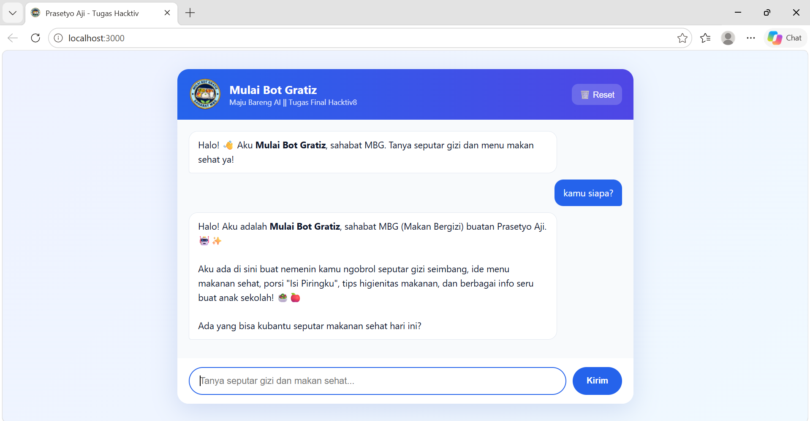

# Mulai Bot Gratiz - Chatbot Gizi Berbasis Gemini AI

Chatbot asisten gizi dan makan sehat buatan **Prasetyo Aji** (Hacktiv8 - AI Productivity and AI API Integration for Developers). Dibangun dengan **Node.js + Express** (backend), **Vanilla JavaScript** (frontend), dan **Google Gemini API**.



## Fitur

- **Streaming respons**: jawaban tampil sambil diketik, tidak perlu menunggu sampai selesai.
- **Memori multi-turn**: riwayat percakapan dikirim ke backend (maksimal 20 pesan terakhir).
- **System instruction**: persona "Mulai Bot Gratiz" yang fokus pada gizi dan menolak topik di luar itu dengan ramah.
- **Retry otomatis** saat server Gemini sibuk (503) atau kena batas sementara (429).
- **Validasi input** di backend dan batas panjang pesan (2000 karakter) agar kuota API tidak boros.
- **Aman dari XSS**: output model di-escape sebelum diformat menjadi HTML.
- Antarmuka: indikator mengetik, format kode dan teks tebal, tombol saran pertanyaan, dan tombol reset.

## Konfigurasi

| Aspek | Penjelasan |
|---|---|
| Use case | Asisten gizi dan makan sehat untuk anak sekolah |
| Model | `gemini-3.5-flash-lite` (dapat diganti lewat `GEMINI_MODEL`) |
| Parameter | `temperature: 0.7`, `topP: 0.9`, `topK: 40` |
| Memori | 20 pesan terakhir |

## Arsitektur

`Browser (fetch POST /api/chat)` → `Express (index.js)` → `Gemini generateContentStream()` → `stream teks` → tampil di chat.

## Cara Menjalankan

1. Pasang Node.js v18 atau lebih baru.
2. Salin `.env.example` menjadi `.env`, lalu isi API key dari https://aistudio.google.com/apikey :
   ```
   GEMINI_API_KEY=api_key_kamu
   GEMINI_MODEL=gemini-3.5-flash-lite
   ```
   `GEMINI_MODEL` bersifat opsional. Nama model Gemini berganti cukup sering, jadi jika muncul error 404 model, ganti dengan model yang tersedia untuk akunmu.
3. Pasang dependensi dan jalankan:
   ```bash
   npm install
   npm start
   ```
4. Buka http://localhost:3000

## Struktur

```
├── index.js          # server Express + endpoint Gemini (streaming)
├── public/           # index.html, style.css, script.js, logo
├── docs/             # screenshot
├── .env.example
└── package.json
```

## Catatan Keamanan

API key hanya disimpan di `.env` yang sudah masuk `.gitignore`. Jangan pernah commit file tersebut.